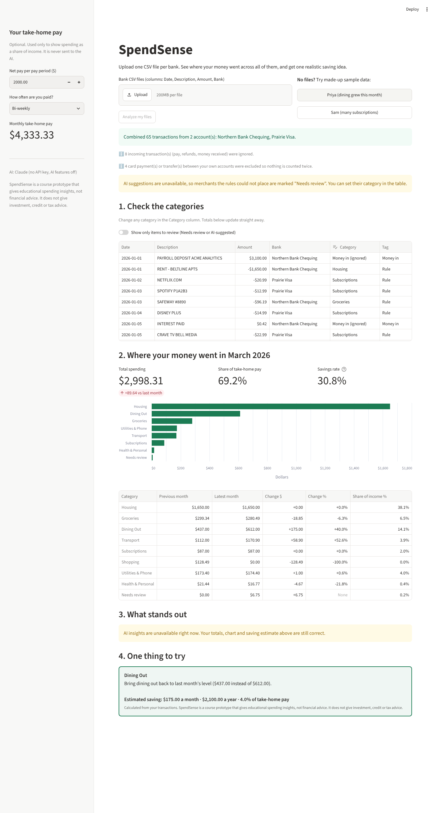

# SpendSense

**See where your money went across all your banks, and get one realistic saving idea.**

SpendSense is a web app for young professionals who bank with more than one institution. You upload one CSV
transaction file per bank. SpendSense combines them, sorts your spending into categories, shows where the
money went this month, and suggests one specific saving with a dollar estimate.

Built for ENTI 633 (Generative AI), MBA program, Haskayne School of Business, University of Calgary, Fall 2026.
Team: Alizeh Chaudhry, Angela Joseph, Justin Liu, Tara O'Desse, David Osah.

> Course prototype. SpendSense gives educational spending insights, not financial advice. It never gives
> investment, credit or tax advice. All data in this repository is made up.



## Main features

- **Multi-bank upload.** One CSV per bank. Reads SpendSense's own layout (Date, Description, Amount, Bank) and common
  bank exports: other column names (Transaction Date, CAD$, Description 1/2), separate Debit/Credit or
  Withdrawals/Deposits columns, files with no header row (TD/CIBC style), and credit cards that show purchases as
  positive numbers (detected automatically, with a per-file override under *How your files were read*). Account
  numbers, balances and any other extra columns are dropped first.
- **No double counting.** Money coming in (pay, refunds) is ignored. Credit-card payments and transfers between
  your own accounts go to *Transfers (excluded)*.
- **Categories you can fix.** Merchant rules place most transactions. Claude suggests a category for the rest,
  tagged *AI-suggested*. Anything still unplaced is marked *Needs review*. Change any category in one click and
  every total updates.
- **Where your money went.** Totals by category, a bar chart, and the change from last month. Enter your
  take-home pay (optional) to see each category as a share of income and your savings rate.
- **3-4 plain-language insights** written by Claude from the calculated totals.
- **One thing to try.** A single saving suggestion. The dollar estimate is always calculated in code.

## How it works

```
CSV files ──► loader.py ──► categorize.py ──► analysis.py ──► app.py (Streamlit page)
             check, clean,   merchant rules     totals, month-over-     table, chart,
             drop extra      ▲                  month, income share,    insight cards,
             columns         │ unplaced         saving estimate         suggestion card
                             │ merchants only          │ totals and %
                             └──── ai.py (Claude) ◄────┘ only
                                   number check + advice filter
```

**Rule: code does the math, AI does the explaining.**

| Step | Done by | What the AI sees |
|---|---|---|
| Read, check, combine files | Code (`core/loader.py`) | nothing |
| Categories | Rules first (`core/categorize.py`), Claude for unplaced merchants | merchant names only |
| Totals, changes, income share, saving estimate | Code (`core/analysis.py`) | nothing |
| Insights and suggestion wording | Claude (`core/ai.py`) | category totals and percentages, never transactions or the income amount |

Safeguards in `core/ai.py`:
- Every dollar figure and percentage in Claude's text is compared with the calculated numbers. An insight with a
  number that does not match is hidden, and the page says how many were hidden.
- Text that mentions investing, credit, loans or tax is hidden.
- If there is no API key or the call fails, the app still shows every category, total, chart and the saving
  estimate. It shows a notice with the reason (no key, key rejected, no credit, model not found, network) and a
  Retry button.

## Run it on your laptop

You need Python 3.11 or newer.

```bash
git clone <this repository>
cd spendsense
python -m venv .venv
source .venv/bin/activate          # Windows: .venv\Scripts\activate
pip install -r requirements.txt
cp .env.example .env               # then paste your Anthropic API key into .env
streamlit run app.py
```

The app opens at http://localhost:8501. Click **Priya** or **Sam** to try the sample data. Without an API key the
app still works, with the AI features switched off.

**Publish on Streamlit Community Cloud:** connect this repository at share.streamlit.io, choose `app.py`, and paste
the key into the app's **Settings > Secrets** in the format shown in `.streamlit/secrets.toml.example`.

## Sample data

`data/sample/` holds made-up files for two personas, made by `scripts/make_sample_data.py`. Some values are
planted so that testers know the right answer:

| Persona | Files | Planted answers |
|---|---|---|
| Priya, dining grew | `priya_northern_chequing.csv` (40 rows, includes an Account Number column to be dropped), `priya_prairie_visa.csv` (25 rows) | Dining Out $437.00 in Feb, $612.00 in Mar (+40.0%); 5 subscriptions = $87.00/month; card payment of $1,250.00 in March; one merchant the rules cannot place (`SQ *MOUNTAIN BREW`, $6.75) |
| Sam, subscription creep | `sam_bowvalley_chequing.csv`, `sam_chinook_mastercard.csv` | 8 subscriptions = $142.90/month; dining flat |

`data/bad/` holds files for the error tests: a PDF, a CSV with no Amount column, an empty file, odd amounts and a
2,000-row file.

## Test evidence

**Automated:** `python -m pytest -q` runs 24 checks (24 passed on 22 Nov 2026):
combining two banks into 65 rows with no account numbers, $87.00 subscriptions, dining $437.00 to $612.00
(+40.0%), fixing a category updates the total, card payments excluded, income conversion (2,000 bi-weekly =
$4,333.33 a month), dining = 14.1% of income, both saving suggestions, the three bad files, odd amounts, the
2,000-row file, the number check, the advice filter, the no-API-key fallback and its message, a rejected API key,
and real-bank layouts (positive credit-card purchases, sign override, RBC-style columns, TD-style file with no header,
BMO-style compact dates, Withdrawals/Deposits columns).

**Click-through:** the acceptance tests in `PRD.md` are run by a person before each saved version. Results:

| # | Test | Result | Date | Tester |
|---|---|---|---|---|
| 1 | Two Priya files combine to 65 rows, no account numbers | Pass (screenshot above) | 21 Nov 2026 | Claude (automated browser) |
| 2 | Subscriptions for March show $87.00 | Pass (screenshot above) | 21 Nov 2026 | Claude (automated browser) |
| 3 | Change `SQ *MOUNTAIN BREW` to Dining Out: Dining Out becomes $618.75 | Pass ([screenshot](docs/screenshots/after_category_fix.png)) | 21 Nov 2026 | Claude (automated browser) |
| 6 | Income $2,000 bi-weekly: $4,333.33/month, Dining Out 14.1% | Pass (screenshot above) | 21 Nov 2026 | Claude (automated browser) |
| 7 | $1,250 card payment excluded; incoming transactions ignored, with notes | Pass (screenshot above) | 21 Nov 2026 | Claude (automated browser) |
| 8 | PDF, missing Amount and empty file each give a plain message | Pass ([screenshot](docs/screenshots/error_messages.png)) | 21 Nov 2026 | Claude (automated browser) |
| 9 | No API key: totals, chart and suggestion still show, with notices | Pass | 21 Nov 2026 | Claude (automated browser) |
| 10 | Reload clears all data | Pass | 21 Nov 2026 | Claude (automated browser) |
| 4, 5 | Insights quote only real numbers; suggestion wording from Claude | To test with an API key | | |

## Known limitations

- Bank exports vary. Common Canadian layouts are handled, but an unusual file may need its columns renamed or its
  spending sign set by hand under *How your files were read*.
- Merchant rules are a starter list for Calgary-area merchants. Unknown merchants depend on Claude or the user.
- Refunds are ignored as money in, so a refunded purchase still counts as spending.
- A transfer to another person (for example, rent by e-transfer) is counted as spending unless the user changes it.
- The saving estimate for subscriptions uses the two cheapest subscriptions, because the app cannot know which
  ones the user actually uses.
- Nothing is saved between visits, by design. The user re-uploads files each time.
- Not financial advice; no investment, credit, debt or tax guidance.

## AI-use disclosure

- **In the product:** Claude (Anthropic API, default model `claude-haiku-5-5`, set with `CLAUDE_MODEL`) suggests
  categories for unplaced merchant names and writes the insight and suggestion wording from calculated totals.
- **In development:** the first working version of the code, the sample-data generator, the tests and this README
  were drafted with Claude (claude.ai, Claude Opus 5.5) from our project proposal and build-kit spec, then
  reviewed, tested and edited by the team. Prompts and agent interactions are recorded in `build-log.md`.

## Team contributions

| Member | Contribution |
|---|---|
| Alizeh Chaudhry | [to be completed] |
| Angela Joseph | [to be completed] |
| Justin Liu | [to be completed] |
| Tara O'Desse | [to be completed] |
| David Osah | [to be completed] |

## Open-source components

Streamlit (Apache 2.0), pandas (BSD 3-Clause), Altair (BSD 3-Clause), Anthropic Python SDK (MIT),
python-dotenv (BSD 3-Clause), pytest (MIT).

## Licence

MIT. See `LICENSE`.
